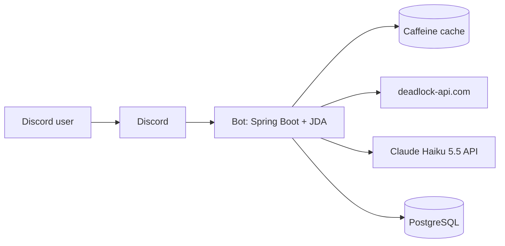

# Architecture

## Overview
A single Spring Boot application running a Discord bot via JDA. It fetches match data from the community Deadlock API, computes metrics locally, and asks Claude Haiku 5.5 to turn those metrics into advice.



## Stack
| Concern | Choice | ADR |
|---|---|---|
| Language / runtime | Java 21 (virtual threads) | 0001 |
| Framework | Spring Boot 4.1, no web server at first | 0001 |
| Discord library | JDA 5 | 0001 |
| Database | PostgreSQL + Spring Data JPA | 0002 |
| Cache | Caffeine via Spring Cache | 0002 |
| Match data | deadlock-api.com (community, unofficial) | 0004 |
| AI | Claude Haiku 5.5 (`claude-haiku-5-5`) | 0003 |
| Deployment | Docker Compose on Oracle Cloud Always Free (ARM) | 0005 |
| Payments | Patreon + Discord role check | 0006 |

## Package layout
```
src/main/java/<base>/
├── commands/      Slash commands: validate input, reply. No business logic.
├── services/      Business logic (analysis, profiles, usage limits).
├── clients/       External APIs (Deadlock API, Claude). Always cached.
├── repositories/  Spring Data JPA repositories.
├── domain/        Entities and value objects.
└── config/        JDA, cache, HTTP clients, properties.
```

## Main flow: `/analyze`
1. `AnalyzeCommand` validates the user and calls `deferReply()`.
2. `UsageService` checks the weekly limit (skipped if the user has the Premium role).
3. `DeadlockApiClient` fetches recent matches (cached).
4. `MetricsService` computes a compact summary (KDA, souls/min, item timings, comparison to rank average).
5. `AnalysisClient` sends only that summary to Claude Haiku 5.5 with low effort and a `max_tokens` cap.
6. The result is stored (so the same match is never paid for twice) and returned as an English embed (all user-facing text from `messages.properties`).

## Non-functional guidelines
- Memory: `-Xmx512m`, only required starters, `spring.main.web-application-type=none` until webhooks are needed.
- Never send raw API JSON to the AI. Keep prompts well under 100K tokens (pricing tier jump).
- Respect the community API: cache responses, back off on errors.
- Secrets (Discord token, Anthropic key) only via environment variables.
